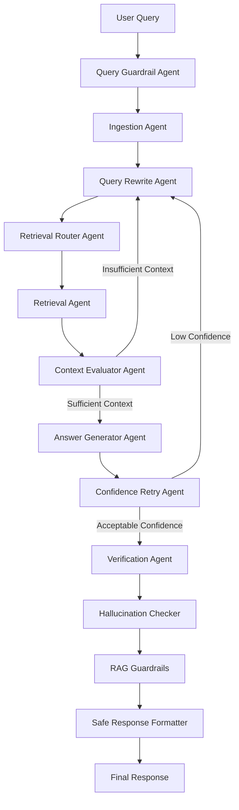

# Orchestrix Veritas

Orchestrix Veritas is an agentic multimodal RAG platform for financial, regulatory, and business documents.

## Features

- Document type detection
- Content analyzer agent
- Chunk strategy planner
- Recursive chunking
- Metadata enrichment
- Local embedding wrapper
- In-memory vector store
- Dense retrieval
- BM25 keyword retrieval
- Hybrid retrieval with Reciprocal Rank Fusion
- Simple reranking
- Citation-aware answer generation
- Answer verification
- Guardrails
- Lightweight LangGraph-style workflow
- Retrieval evaluation metrics
- FastAPI endpoint
- CLI runner

## Architecture

```text
File
  -> Content Analyzer
  -> Chunk Strategy Planner
  -> Parser
  -> Chunking Agent
  -> Metadata Agent
  -> Embedding Agent
  -> Vector Store
  -> Hybrid Retrieval
  -> Reranker
  -> Answer Generator
  -> Verification Agent
```

## Verification and Guardrails Layer

The project now includes a verification and guardrails layer after answer generation.

### Flow

```text
Retrieved Chunks
      ↓
Answer Generator Agent
      ↓
Verification Agent
      ↓
Hallucination Checker
      ↓
RAG Guardrails
      ↓
Safe Response Formatter
      ↓
Final 
```

## Final Orchestrator Output

The orchestrator now returns:

{## Components

### 🤖 Answer Generator Agent

Responsible for generating grounded answers using the retrieved document chunks.

**Responsibilities**

* Generates answers from the retrieved document context.
* Uses **Ollama** as the local Large Language Model (LLM) when available.
* Falls back to context stitching if the LLM is unavailable.
* Produces structured output including:

  * Answer
  * Citations
  * Source information
  * Confidence score
  * Grounding metadata

---

### ✅ Verification Agent

Acts as the verification layer between answer generation and the final response.

**Responsibilities**

* Verifies that the generated answer is supported by the retrieved documents.
* Integrates answer verification and hallucination detection.
* Supports both:

  * Direct verification using a generated result object.
  * Orchestrator-based verification using the answer and retrieved chunks.
* Returns verification status, grounding information, and validation issues.

---

### 🔍 Answer Verifier

Performs deterministic validation of the generated answer.

**Checks Performed**

* Answer is not empty.
* Supporting context exists.
* Citations are present.
* Confidence score meets the configured threshold.

This component ensures that only sufficiently supported answers proceed to the next stage.

---

### 🧠 Hallucination Checker

Identifies potential hallucinations before the response is returned.

**Checks Performed**

* Answer exists without supporting context.
* Answer exists without citations.
* Confidence score is below the minimum threshold.

Instead of attempting to detect hallucinations perfectly, this component provides a practical risk assessment that can be used by downstream guardrails.

---

### 🛡️ RAG Guardrails

Applies safety and quality rules before the response is returned to the user.

**Responsibilities**

* Prevents unsafe or low-quality responses from being treated as verified.
* Detects:

  * Empty answers
  * Missing citations
  * Hallucination risks
  * Failed verification
* Produces:

  * Safety status
  * Warning messages
  * Response eligibility (`safe_to_return`)

---

### 📦 Safe Response Formatter

Formats the final API-ready response after all verification stages have completed.

**Responsibilities**

* Returns a clean, user-facing response.
* Preserves:

  * Answer
  * Citations
  * Sources
  * Confidence score
  * Verification status
* Returns a safe fallback message whenever the response fails the configured guardrails.

This component serves as the final presentation layer before the response is delivered to the user.

```

    "answer": "...",
    "citations": [...],
    "sources": [...],
    "confidence": 0.95,
    "verified": True,
    "is_grounded": True,
    "guardrails": {...},
    "safe_to_return": True,
    "final_response": {...}
}
```

## 💼 Explanation

In this project, I did not directly return the LLM answer. After retrieval and answer generation, I added a verification layer to check grounding, confidence, citations, and hallucination risk. Then I applied guardrails and formatted a safe final response. This makes the RAG system more production-ready because it reduces unsupported answers and gives clear metadata for debugging and evaluation.


Then run:

```bash

pytest

Expected:

64 passed

```
After that, this phase is complete.

## Phase 2: Agentic RAG Workflow

Phase 2 upgrades the project from a procedural RAG pipeline into an agentic workflow.

Instead of simply retrieving context and generating an answer, the system now performs query rewriting, context evaluation, retry logic, answer verification, hallucination checks, guardrails, and final safe response formatting.

### Agentic Workflow

```text
User Query
    ↓
Query Guardrail Check
    ↓
Document Ingestion
    ↓
Query Rewrite Agent
    ↓
Retrieval Agent
    ↓
Context Evaluator Agent
    ↓
Is context sufficient?
    ├── No → Rewrite query and retrieve again
    └── Yes
          ↓
Answer Generator Agent
    ↓
Verification Agent
    ↓
RAG Guardrails
    ↓
Safe Response Formatter
    ↓
Final Response
```
# 🚀 Phase 2: Agentic RAG Workflow

Phase 2 transforms **Orchestrix Veritas** from a traditional Retrieval-Augmented Generation (RAG) pipeline into an **Agentic RAG workflow**.

Instead of performing a single retrieval followed by answer generation, the system now evaluates the retrieved context, rewrites the query when necessary, retries retrieval, verifies the generated answer, applies safety guardrails, and returns a structured, production-ready response.

---

## 🎯 Objectives

* Introduce an **Agentic AI workflow** using a shared workflow state.
* Improve retrieval quality through **query rewriting**.
* Evaluate retrieved context before generating an answer.
* Support **automatic retry loops** when insufficient context is found.
* Increase answer reliability through **verification and hallucination detection**.
* Produce safe, structured, API-ready responses.

---

# 🏗️ Agentic Workflow

```text
                   User Query
                        │
                        ▼
             Query Guardrail Check
                        │
                        ▼
              Document Ingestion
                        │
                        ▼
              Query Rewrite Agent
                        │
                        ▼
               Retrieval Agent
                        │
                        ▼
           Context Evaluator Agent
                        │
            ┌───────────┴───────────┐
            │                       │
            │ Context Sufficient?   │
            │                       │
            └───────┬───────────────┘
                    │
        ┌───────────┴───────────┐
        │                       │
      No ▼                     ▼ Yes
 Rewrite Query            Generate Answer
        │                       │
        └──────────────┬────────┘
                       ▼
              Verification Agent
                       │
                       ▼
                RAG Guardrails
                       │
                       ▼
          Safe Response Formatter
                       │
                       ▼
                Final Response
```

---

# 🧩 Phase 2 Components

## 📌 RAGState

The shared workflow state used by every node in the graph.

### Responsibilities

* Stores the original user query.
* Stores rewritten queries during retry loops.
* Tracks retrieved document chunks.
* Stores generated answers.
* Maintains verification and guardrail results.
* Records workflow events for debugging and observability.
* Preserves workflow state across every graph node.

---

## 🔄 Query Rewrite Agent

Improves retrieval quality by rewriting or expanding the user's query whenever retrieved context is insufficient.

### Responsibilities 

* Cleans the original query.
* Expands the query during retry attempts.
* Produces retrieval-friendly search queries.
* Increases the likelihood of retrieving relevant document chunks.

---

## 📊 Context Evaluator Agent

Determines whether the retrieved document context is sufficient for answer generation.

### Evaluation Criteria

* Number of retrieved chunks.
* Average retrieval score.
* Minimum confidence threshold.

### Responsibilities

* Determines whether the workflow should continue.
* Triggers another retrieval attempt if necessary.
* Prevents answer generation using weak or insufficient context.

---

## 🕸️ OrchestrixGraph

The central workflow engine responsible for coordinating every stage of the Agentic RAG pipeline.

### Workflow Responsibilities

1. Validate the incoming query.
2. Ingest documents.
3. Rewrite the query when required.
4. Retrieve relevant document chunks.
5. Evaluate retrieved context.
6. Retry retrieval if context is insufficient.
7. Generate a grounded answer.
8. Verify the generated answer.
9. Apply safety guardrails.
10. Format the final API-ready response.

---

## 🔁 Retry Loop

Unlike traditional one-shot RAG systems, Orchestrix Veritas supports **automatic retrieval retries**.

When insufficient context is retrieved:

1. The query is rewritten.
2. Retrieval is executed again.
3. Context is re-evaluated.
4. The workflow proceeds only after sufficient context is available or the retry limit is reached.

This significantly improves retrieval quality and answer reliability.

---

## 📈 Workflow Events

Every graph node records execution events.

Example events include:

* `workflow_started`
* `guardrail_node_completed`
* `ingest_node_completed`
* `rewrite_query_node_completed`
* `retrieve_node_completed`
* `evaluate_context_node_completed`
* `retry_triggered`
* `answer_node_completed`
* `verify_node_completed`
* `rag_guardrails_node_completed`
* `final_response_node_completed`
* `workflow_completed`

These events improve:

* Debugging
* Observability
* Workflow tracing
* Production monitoring
* Interview demonstrations

---

# ⭐ Key Improvements Over Traditional RAG

| Traditional RAG             | Orchestrix Veritas Phase 2                            |
| --------------------------- | --------------------------------------------------- |
| Single retrieval attempt    | Multiple retrieval attempts with retry logic        |
| Static user query           | Dynamic query rewriting                             |
| Immediate answer generation | Context evaluation before generation                |
| No workflow state           | Shared workflow state (`RAGState`)                  |
| Limited observability       | Full workflow event tracking                        |
| No retry mechanism          | Automatic retry loop                                |
| Minimal validation          | Verification + Hallucination Detection + Guardrails |

---

# 💼 Explanation

Orchestrix Veritas implements an **Agentic Retrieval-Augmented Generation (RAG)** architecture rather than a traditional linear RAG pipeline.

The system maintains a shared workflow state throughout execution. After retrieving document chunks, it evaluates whether the retrieved context is sufficient to answer the user's question. If the retrieved information is inadequate, the workflow automatically rewrites the query and performs another retrieval attempt.

Once sufficient context has been collected, the workflow generates a grounded answer, verifies its quality, performs hallucination detection, applies safety guardrails, and formats a clean, API-ready response.

This iterative workflow provides greater robustness, improved retrieval quality, better traceability, enhanced observability, and safer responses, making the system suitable for production-grade enterprise AI applications.

---

# ✅ Phase 2 Highlights

* Agentic workflow execution
* Shared workflow state management
* Intelligent query rewriting
* Context sufficiency evaluation
* Automatic retrieval retry loop
* Workflow event tracking
* Verification and hallucination detection
* Guardrails for response safety
* Safe API response formatting
* Production-ready modular architecture

## Architecture Diagram



---

## 3. Run final checks

```bash

pytest

```
Then run API:

```bash

uvicorn orchestrix_veritas.api.main:app --reload

```
Open:

```bash

http://127.0.0.1:8000/docs

```

## 📂 Project Structure

```text
orchestrix_veritas/
│
├── agents/
│   ├── answer_generator_agent.py
│   ├── confidence_retry_agent.py
│   ├── context_evaluator_agent.py
│   ├── guardrail_agent.py
│   ├── ingestion_agent.py
│   ├── metadata_agent.py
│   ├── parsing_agent.py
│   ├── query_rewrite_agent.py
│   ├── retrieval_agent.py
│   ├── retrieval_router_agent.py
│   ├── verification_agent.py
│   ├── document_intelligence_agent.py
│   ├── embedding_agent.py
│   ├── chunking_agent.py
│   └── rag_orchestrator_agent.py
│
├── api/
│   └── main.py
│
├── chunking/
│   ├── page_aware_chunker.py
│   ├── recursive_chunker.py
│   ├── toc_chunker.py
│   └── ...
│
├── embeddings/
│   ├── local_embedding_model.py
│   └── ...
│
├── evaluation/
│   ├── retrieval_metrics.py
│   └── ...
│
├── guardrails/
│   ├── rag_guardrails.py
│   └── safe_response_formatter.py
│
├── llm/
│   ├── ollama_client.py
│   └── prompt_builder.py
│
├── metadata/
│
├── models/
│
├── parsers/
│   ├── csv_parser.py
│   ├── docx_parser.py
│   ├── image_parser.py
│   ├── pdf_parser.py
│   ├── ppt_parser.py
│   ├── text_parser.py
│   └── xlsx_parser.py
│
├── retrieval/
│   ├── bm25_search.py
│   ├── dense_search.py
│   ├── hybrid_search.py
│   ├── query_router.py
│   ├── reranker.py
│   ├── rrf.py
│   └── ...
│
├── vectorstore/
│   ├── in_memory_vector_store.py
│   ├── qdrant_dense_search.py
│   ├── qdrant_manager.py
│   └── ...
│
├── verification/
│   ├── answer_verifier.py
│   ├── hallucination_checker.py
│   └── faithfulness.py
│
├── tests/
│   ├── test_answer_generator_agent.py
│   ├── test_api_main.py
│   ├── test_confidence_retry_agent.py
│   ├── test_context_evaluator_agent.py
│   ├── test_graph_retrieval_router.py
│   ├── test_langgraph_build.py
│   ├── test_query_rewrite_agent.py
│   ├── test_rag_guardrails.py
│   ├── test_verification_agent.py
│   └── ... (80+ automated tests)
│
├── cli.py
├── graph.py
├── state.py
├── document_detector.py
├── config.py
├── app.py
├── requirements.txt
├── Dockerfile
└── README.md
```

---

# 🚀 Running the Project

## 1. Clone the Repository

```bash

git clone <repository-url>
cd orchestrix-veritas

```

---

## 2. Create a Virtual Environment

### Windows

```bash

python -m venv .mvenv

.mvenv\Scripts\activate

```

### macOS / Linux

```bash

python3 -m venv .mvenv
source .mvenv/bin/activate

```

---

## 3. Install Dependencies

```bash

pip install -r requirements.txt

```

---

## 4. Run All Tests

```bash

pytest

```

Expected output:

```text

87+ tests passed

```

---

## 5. Run the CLI Application

```bash
python -m orchestrix_veritas.cli
```

Example:

```text

======================================================================
            Orchestrix Veritas - Agentic RAG CLI
======================================================================

Ask a question:
> What increased in 2024?

Answer:
Revenue increased by 25% in 2024.

Sources:
sample.txt

Confidence:
0.95

Verification:
Passed

Workflow Events:
workflow_started
guardrail_node_completed
retrieve_node_completed
...
```

---

## 6. Run the FastAPI Server

```bash
uvicorn orchestrix_veritas.api.main:app --reload
```

API documentation is available at:

```text

http://127.0.0.1:8000/docs

```

---

# 🌟 Current v1.0 Features

## 📄 Document Processing

* Multi-format document ingestion
* Automatic document type detection
* Metadata extraction
* PDF parsing
* DOCX parsing
* PPTX parsing
* CSV parsing
* XLSX parsing
* Image parsing
* Plain text parsing

---

## ✂️ Intelligent Chunking

* Recursive chunking
* TOC-aware chunking
* Page-aware chunking
* Metadata-aware chunking
* Hierarchical chunk preparation

---

## 🧠 Embeddings & Vector Search

* Local embedding generation
* In-memory vector store
* Qdrant integration
* Dense vector retrieval

---

## 🔍 Retrieval Techniques

* Dense Retrieval
* BM25 Retrieval
* Hybrid Retrieval
* Reciprocal Rank Fusion (RRF)
* Reranking
* Retrieval Router
* Query Rewriting
* Context Evaluation

---

## 🤖 Agentic Workflow

* Query Guardrails
* Query Rewrite Agent
* Retrieval Router Agent
* Retrieval Agent
* Context Evaluator Agent
* Confidence Retry Agent
* Answer Generator Agent
* Verification Agent
* Hallucination Checker
* RAG Guardrails
* Safe Response Formatter
* LangGraph-compatible Workflow
* Shared Workflow State Management

---

## 📊 Response Quality

* Confidence estimation
* Citation generation
* Source attribution
* Grounded answer verification
* Hallucination detection
* Safe response validation

---

## 🖥️ Interfaces

* Interactive CLI
* FastAPI REST API
* Swagger UI
* Docker support

---

## 🧪 Testing

* Comprehensive automated test suite
* Agent-level unit tests
* Retrieval tests
* Verification tests
* Graph workflow tests
* API endpoint tests
* CLI tests

---

# 🎯 Version Summary

| Category                 | Status      |
| ------------------------ | ----------- |
| Agentic Workflow         | ✅           |
| LangGraph-Compatible     | ✅           |
| Multi-Parser Support     | ✅           |
| Hybrid Retrieval         | ✅           |
| Query Rewriting          | ✅           |
| Retrieval Routing        | ✅           |
| Context Evaluation       | ✅           |
| Retry Logic              | ✅           |
| Verification             | ✅           |
| Hallucination Detection  | ✅           |
| RAG Guardrails           | ✅           |
| Safe Response Formatting | ✅           |
| FastAPI                  | ✅           |
| CLI                      | ✅           |
| Docker                   | ✅           |
| Automated Testing        | ✅ 87+ Tests |
| Production Ready         | ✅           |

---

# 🏆 Project Status

**Orchestrix Veritas v1.0** is a production-style, modular Agentic Retrieval-Augmented Generation (RAG) platform designed for financial and regulatory document intelligence.

The project combines modern RAG techniques with an agent-based workflow, incorporating query rewriting, intelligent retrieval routing, context evaluation, confidence-based retry logic, answer verification, hallucination detection, safety guardrails, and LangGraph-compatible orchestration. It is packaged with an interactive CLI, REST API, automated testing, and Docker support, making it suitable as both a portfolio project and a foundation for enterprise AI applications.

